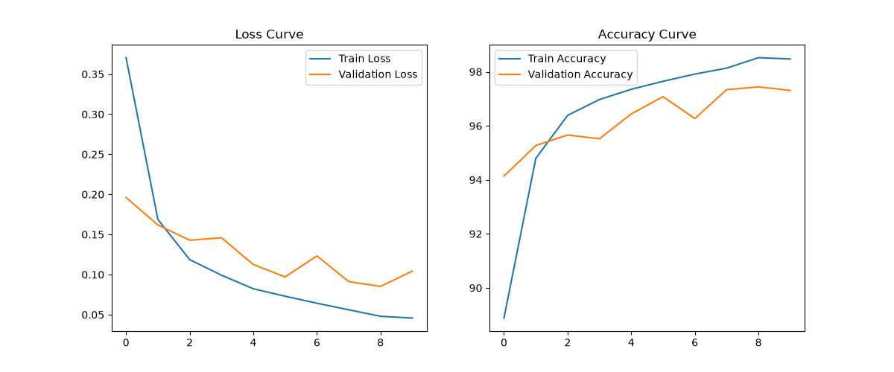

# MNIST Veri Seti ile MLP Tabanlı El Yazısı Rakam Tanıma

Bu proje kapsamında, MNIST el yazısı rakam veri seti kullanılarak PyTorch tabanlı bir Multi-Layer Perceptron (MLP) modeli sıfırdan geliştirilmiş, eğitilmiş ve performansı değerlendirilmiştir. CNN (Evrişimli Sinir Ağı) kullanılmamış, sadece MLP mimarisine odaklanılmıştır.

## Deney 1: Temel MLP Modeli

Model sıfırdan oluşturulmuş olup hazır bir ağırlık (pre-trained model) kullanılmamıştır. Eğitim süreci Train, Validation ve Test olmak üzere 3 farklı veri kümesi üzerinden yürütülmüştür.

### Kullanılan Hiperparametreler
* **Gizli Katman (Hidden Layer) Sayısı:** 2 (256 ve 128 nöronluk katmanlar)
* **Aktivasyon Fonksiyonu:** ReLU
* **Loss Fonksiyonu:** CrossEntropyLoss
* **Optimizer:** Adam
* **Learning Rate (Öğrenme Oranı):** 0.001
* **Batch Size:** 64
* **Epoch:** 10

### Eğitim Sonuçları
* **Train Accuracy:** %98.45
* **Validation Accuracy:** %97.32
* **Test Accuracy:** %97.59
* **Toplam Eğitim Süresi:** 65.29 saniye

### Loss ve Accuracy Grafikleri

---

## Deney 2: Kendi El Yazısı Verimle Modelin Test Edilmesi

Modelin gerçek dünya verisi üzerindeki başarısını (Generalization) ölçmek için kendi öğrenci numaramı (24120205060) bilgisayar ortamında çizerek modele test verisi olarak sundum.

**Veri Ön İşleme (Data Preprocessing):**
MNIST veri seti siyah arka plan üzerine beyaz rakamlardan oluştuğu için, hazırladığım görselleri modele vermeden önce `ImageOps.invert` ile renklerini tersine çevirdim, gri tonlamaya (Grayscale) aldım, 28x28 piksel boyutuna yeniden ölçeklendirdim ve normalize ettim.

**Test Sonuçları (Öğrenci No: 2 4 1 2 0 2 0 5 0 6 0):**
* Rakam 1 (2): Doğru
* Rakam 2 (4): Yanlış (Model 2 zannetti)
* Rakam 3 (1): Doğru
* Rakam 4 (2): Doğru
* Rakam 5 (0): Doğru
* Rakam 6 (2): Doğru
* Rakam 7 (0): Yanlış (Model 6 zannetti)
* Rakam 8 (5): Doğru
* Rakam 9 (0): Yanlış (Model 7 zannetti)
* Rakam 10 (6): Yanlış (Model 5 zannetti)
* Rakam 11 (0): Yanlış (Model 6 zannetti)

**Toplam Başarı:** 11 rakamın 6'sı doğru tahmin edilmiştir.

### Değerlendirme ve Sonuç (Generalization & Distribution Shift)
Model, MNIST test setinde %97+ gibi yüksek bir doğruluk oranına ulaşmasına rağmen, kendi hazırladığım veride bazı rakamlarda yanılmıştır. Bunun temel sebebi **Distribution Shift (Dağılım Kayması)** problemidir. 

MNIST veri setindeki rakamlar, insanların kağıda doğal bir şekilde karaladığı, etrafında belli bir boşluk (padding) bulunan ve ortalanmış gerçek el yazılarından oluşur. Benim dijital ortamda hazırladığım rakamların çizgi kalınlığı, köşe keskinlikleri ve resim içindeki ölçeği (padding eksikliği) MNIST'in eğitim verisi dağılımından farklı olduğu için model bazı pikselleri yanlış yorumlamıştır (Örneğin çok düz çizilen bir '4' rakamını '2'ye benzetmesi gibi). 

Bu deney, eğitim verisi (Training Data) ile gerçek dünya verisi arasındaki farkların, derin öğrenme modellerinin genelleme (Generalization) kapasitesi üzerindeki etkisini açıkça göstermiştir.
